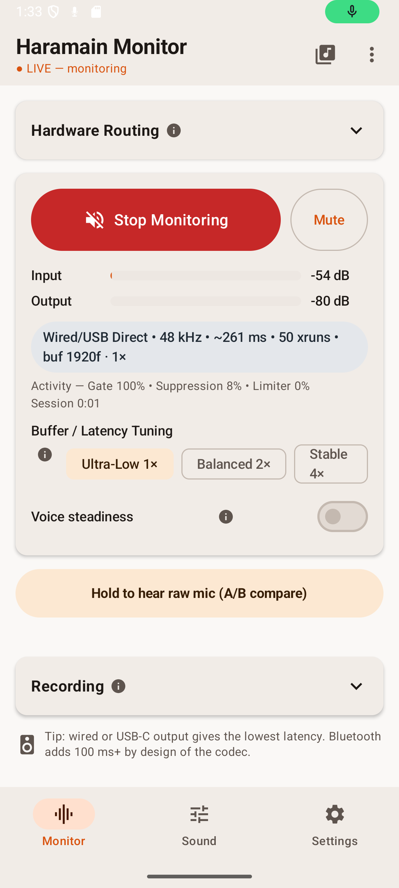
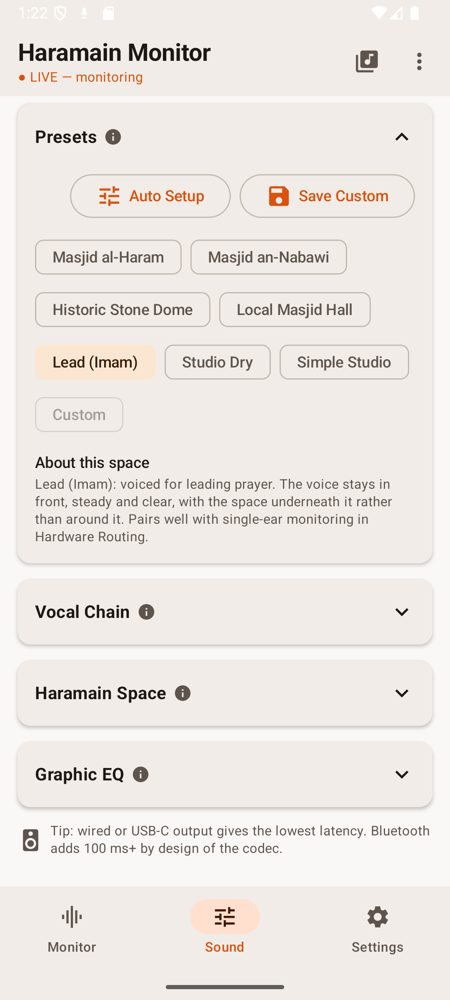
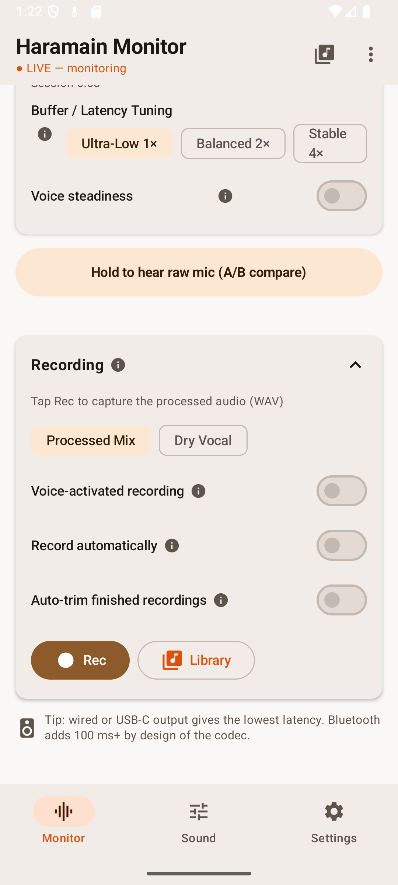
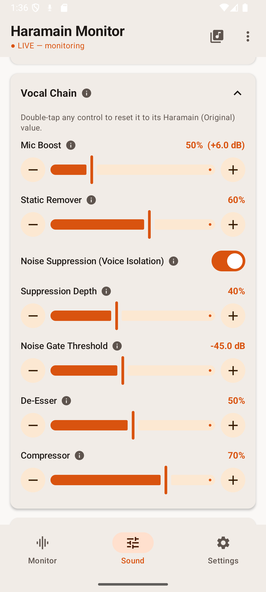
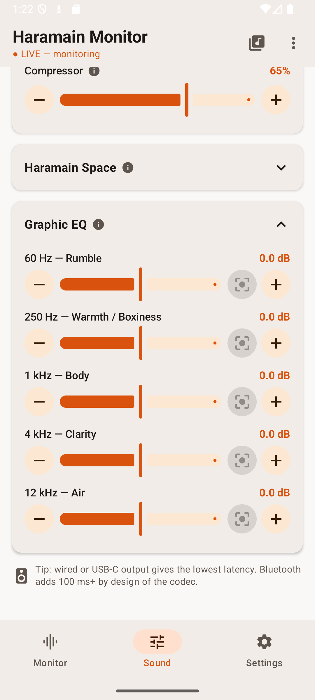
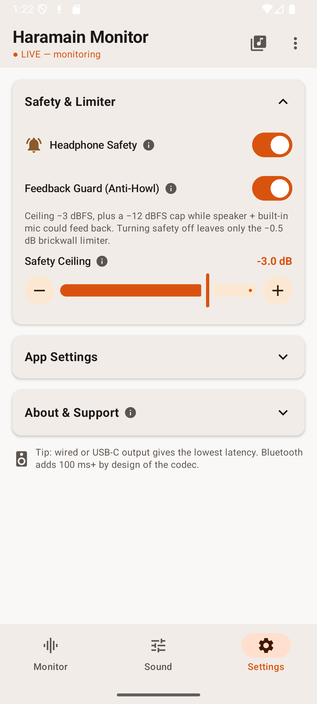
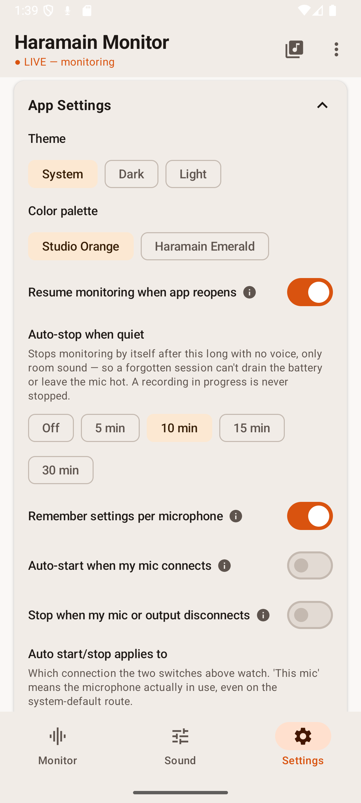
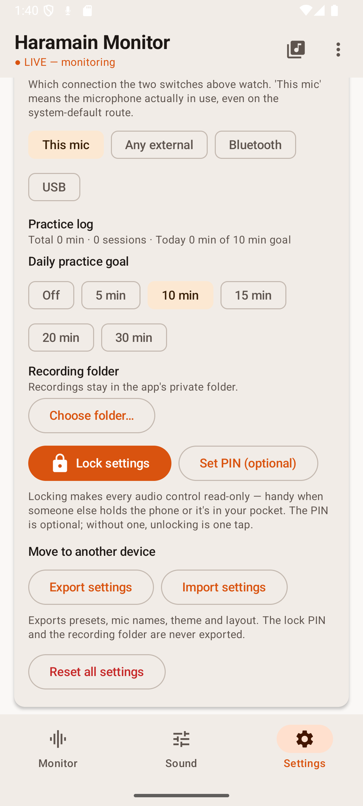
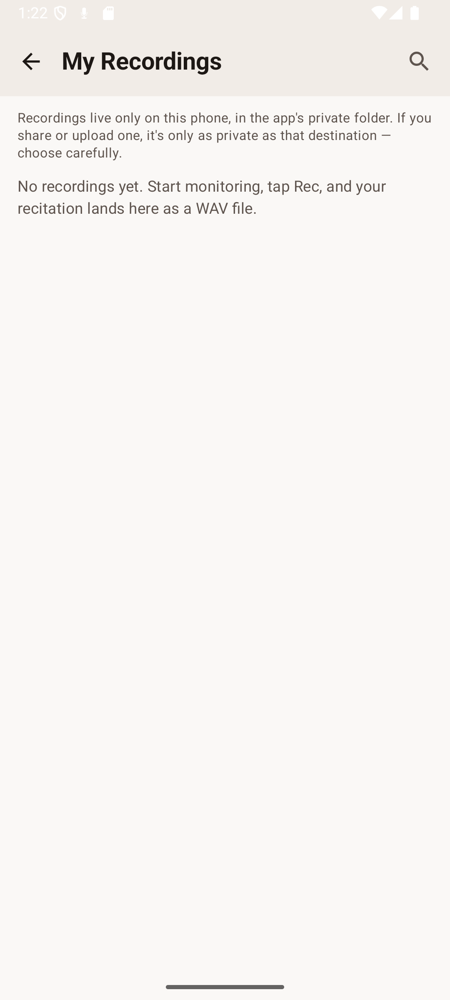

# Haramain Monitor

Ultra-low-latency live microphone monitoring & vocal reverb for Android. Hear
your own voice in headphones in near-real time through a 9-stage C++ DSP rack
(noise gate, noise suppression, de-esser, compressor, 5-band graphic EQ,
tone sculptor, Freeverb hall/studio space, anti-howl notch filter, and
safety limiter) — all offline, with zero ads, zero accounts, and screen-off
foreground service support.

**Who is this for?**
- **Anyone wanting live mic monitoring + reverb on Android:** Plug in
  headphones (or a USB mic), pick **Studio Dry** / **Simple Studio** for
  clean podcast/speech monitoring, or **Masjid al-Haram** / **Historic Stone
  Dome** for lush hall reverb.
- **Qur'an reciters & imams:** Acoustic presets modeled after the two holy
  mosques (*Haramain*), automatic phrase-pause markers (**Waqf marks**) in
  the Library, and a Hz-only **Voice Steadiness** breath mirror for held
  vowels (*madd*).

**Current version:** v4.0 (`versionCode 25`) · **License:** [Apache 2.0](LICENSE) · **Privacy:** [100% offline, on-device only](PRIVACY.md)

**Defaults on first launch — Masjid al-Haram (the user's specified
settings):** Room 95% · Mix 52% · Compressor 70% · De-Esser 50% · Gate −45 dB ·
Safety ON (−3 dBFS ceiling) · Feedback Guard ON.

## Screenshots & Walkthrough

<video src="docs/assets/demo.webm" controls muted playsinline width="360"></video>

| Live Dashboard | Presets | Recording Controls |
|---|---|---|
|  |  |  |
| **Vocal Chain** | **Graphic EQ** | **Safety & Limiter** |
|  |  |  |
| **App Settings** | **Practice & Backup** | **Recordings Library** |
|  |  |  |

*(WebP variants of all screenshots are also included in `docs/assets/`.)*

## Feature reference (v4.0) — the full list

### Live monitoring & sound
- Ultra-low-latency duplex engine (Oboe/AAudio, device-native sample rate,
  exclusive low-latency streams); runs in a foreground service with the
  screen off.
- 9-stage native DSP chain, in order: Mic Boost (soft-knee) -> Static
  Remover (85 Hz high-pass + quiet-only hiss cut) -> Noise Gate (hold +
  hysteresis) -> Noise Suppression (minimum-statistics, floor-relative,
  depth to ~-16 dB) -> De-Esser (split-band, sibilance only) -> Compressor
  (soft knee, auto makeup) -> EQ + 5-band Graphic EQ + reverb (Freeverb
  with damping and stereo width) -> Stereo Balance -> anti-howl notch
  bank -> Safety/Brickwall Limiter (-3 dBFS with Safety on).
- Fixed vocal voicing EQ + user Bass/Treble + 3-band Vocal Tone Sculptor
  (Warmth / Clarity / Air) + 5-band Graphic EQ (60/250/1k/4k/12k).
- Presets: Masjid al-Haram (default; Room 95, Mix 52, Comp 70, De-Esser
  50, Gate -45), Masjid an-Nabawi, Historic Stone Dome, Local Masjid
  Hall, Lead (Imam), Studio Dry, Simple Studio, Auto (calibration),
  Custom (your saved tweaks).
- Processing Activity readout under the meters: Gate %, Suppression %,
  Limiter % and the howl-notch indicator. (Compressor and De-esser
  work silently — readouts for them were tried in v3.3 and removed in
  v3.4: at real levels they sit near zero and added confusion, not
  information.)
- Hold-to-hear-raw A/B compare ("hold to hear raw mic").
- Anti-howl Feedback Guard: FFT detector + harmonic veto parks a narrow
  notch on a ringing frequency before it becomes a howl (12 s expiry).
- Start/stop anti-pop fade (~40 ms); session timer in the meters panel.

### Routing & devices
- Explicit input/output pickers; feedback-risk detection (speaker +
  internal mic caps the limiter at -12 dBFS).
- Monitor Ears: Stereo / Left Only / Right Only (recordings stay stereo).
- Buffer modes: Ultra-Low / Balanced / Stable, with a live telemetry
  pill (buffer frames, device-native rate, xrun count, latency ms).
- Bluetooth suite: Usage::Game output path, dry-ducking for BT delay,
  2-burst buffer floor; platform noise suppression never attaches,
  platform echo cancellation only on speaker routes.
- Per-microphone memory: each mic remembers its own sound (toggleable).
- Teach-it-once mic naming: rename entries, group the phone's duplicate
  entries into physical mics ("Bottom Mic 1/2", "Back Mic 1/2/3"), hide
  entries you never use.
- Auto-start when your mic connects / auto-stop when your mic or
  output disconnects (3 s grace for re-plug or re-pick) — a dropped
  mic never silently becomes the phone mic. Both are keyed to the
  device the engine ACTUALLY routed to (ground truth even on the
  system-default route) and scoped per connection: This mic / Any
  external / Bluetooth only / USB only. If Android blocks a background
  start you get a tap-to-start notification instead.
- Quick Settings tile: tap to start/stop (optimistic), long-press opens
  the app.

### Recording & Library
- Post-DSP stereo WAV recording (or Dry Vocal raw-input mode).
- Auto-record on monitoring start; voice-activated recording (one file
  per take, gate-driven); auto-stop monitoring when quiet (never stops
  a recording in progress).
- Auto-record pairs well with Trim: record hands-free, then cut the
  dead air off both ends of each take with one tap — or turn on
  Auto-trim and every finished recording gets its _trimmed copy
  automatically.
- Library: play / share / delete / export M4A / save to Downloads /
  auto-copy finished takes to a folder you pick (SAF).
- Library review tools: pause/resume, a seek slider, -10s / +10s
  skip buttons, 0.5x / 0.75x / 1x playback with pitch preserved,
  progress readout, A-B phrase loop (Set A / Set B / Loop / Reset)
  with a completion guard so loops don't break out at the end.
  A finished take STAYS loaded at the end — set B, arm the loop,
  or scrub back without replaying from the top.
- Silence Trim (edges only): floor-relative analysis writes a
  "<name>_trimmed.wav" beside the original; originals are never
  touched.
- Waqf marks: "Find waqf marks" on a playing take lists its likely
  phrase endings (level-based envelope analysis, cached in a sidecar
  file); tap a mark to jump playback there. A mirror of where you
  stopped — no pitch judgement.

### Practice
- Practice log: total time, session count, today's time (sessions of
  5 s+ count), stored per-day for 90 days.
- Daily practice goal (Off / 5 / 10 / 15 / 20 / 30 min) with a streak
  counter for consecutive goal days.
- Voice Steadiness (the pitch tracker, reframed): a breath mirror —
  Hz only, no note names, no scoring. Shows how steady your voice
  sits on held sounds (madd) and the level you started at, so you
  can pick one you can sustain.
- Auto Setup calibration: speak for a few seconds and the app measures
  your voice and room, then sets Boost/Gate/Suppression for you.

### App & safety
- Collapsible sections (Presets and App Settings open by default; your
  layout is remembered), every control has a plain-language help text.
- Settings lock with PIN; settings export/import as JSON (mic names,
  section layout, preferences — PIN and recording folder excluded).
- Themes & Color Palettes: System / Light / Dark (pure `#000000` OLED dark
  mode) with two 3-accent palettes — **Studio Orange** (default: Black /
  Espresso-Brown + Studio Orange + Amber-Bronze + Silver-Gray) and
  **Haramain Emerald** (Emerald + Warm Brass + Teal-Cyan).
- Material 3 Navigation & Ergonomics: Left-aligned Top App Bar with
  Library shortcut and 3-dot overflow menu (`⋮`), 3-tab Bottom Navigation
  Bar (**Monitor** · **Sound** · **Settings**), Search + 3-dot action menus
  in Library, and **Reset all settings** with confirmation dialog.
- Earbud / lock-screen mute: media buttons and the system media
  controls toggle mute while monitoring (media session owned by the
  service).
- About & Support section: dynamic version/build info with one-tap
  Copy Diagnostics, inline What's New changelog, FAQ & Quick Guide,
  pre-filled GitHub Bug Report / Feature Request deep-links, live
  System & Diagnostics summary (permissions, audio engine, local
  recordings storage), third-party open-source licenses, and offline
  Privacy Policy & Honesty Disclaimer.

## Presets

| Preset | Boost | Static | Suppress | Gate | De-Esser | Comp | Room | Mix | Character |
|---|---|---|---|---|---|---|---|---|---|
| Masjid al-Haram *(default)* | 50% | 60% | 40% | −45 dB | 50% | 70% | 95% | 52% | Expansive marble-hall reflections with crisp vocal presence |
| Masjid an-Nabawi | 48% | 55% | 35% | −48 dB | 50% | 65% | 82% | 42% | Warm, balanced dome diffusion — gentler and more intimate |
| Historic Stone Dome | 50% | 55% | 35% | −48 dB | 45% | 65% | 75% | 38% | Focused, resonant stone prayer-hall acoustics |
| Local Masjid Hall | 50% | 50% | 35% | −50 dB | 45% | 60% | 45% | 25% | Natural medium community masjid ambiance |
| Lead (Imam) | 50% | 60% | 35% | −50 dB | 45% | 65% | 60% | 30% | Voice in front, steady and clear, with space underneath |
| Studio Dry | 45% | 70% | 50% | −55 dB | 40% | 55% | 0% | 0% | Zero-reverb vocal isolation for clean checking & recording |
| Simple Studio | 50% | 60% | 45% | −50 dB | 40% | 55% | 10% | 6% | Clean, nearly dry, natural speech polish |
| Auto | — | — | — | — | — | — | — | — | Built by Auto Setup from your room noise and voice sample |
| Custom | — | — | — | — | — | — | — | — | Your saved combination (DataStore) |

### Preset research notes

Why "Haramain" is NOT just a name — what the published acoustics say:

- **Masjid al-Haram's raw space rings for almost 6 seconds.** Its long-time
  head of audio, Ahmad Tekin Topuzdag, describes the Grand Mosque's sound
  reverberating ~6 s, with strong room resonances at **212 Hz and 320 Hz**
  (right on Arabic vowel frequencies) that had to be notched out, and a
  processor chain of **gates, limiters, compressors and reverbs** —
  the same stage order this app uses. (topuzdag.com/proaudio.htm)
- **But what worshippers hear is engineered clarity, not raw echo.** A 2025
  *Sound & Vibration* study of the Grand Mosque measured marble-driven late
  reflections arriving after 100 ms that form echoes and *decrease*
  intelligibility, against background noise as high as 90 dB(A) — the whole
  electro-acoustic design (≈7,000+ speakers with millisecond digital delay
  alignment) exists to keep the direct voice dominant. Hence the Haramain
  preset: maximum tail (Room 100%) with a *disciplined* mix (45%, below the
  Original's 52%). (academia.edu/156990437)
- **Masjid an-Nabawi is deliberately the gentler of the two.** Its sound was
  rebuilt after complaints of echo and feedback; accounts of both mosques'
  systems consistently describe Madinah's as sweeter, softer and more
  enclosed/intimate than Makkah's — hence a shorter tail (82%) and lower
  mix (38%). (witnesstv.net, 2026)
- **Preferred reverb for recitation is moderate.** Worshipper-preference
  research (Elkhateeb & Eldakdoky, 2022) found desired mid-frequency
  reverberation for Quran recitation around **1.4–1.8 s** — the presets aim
  at that *perceived* space, not the raw 6 s architecture.
  (researchgate.net/publication/369635142)

## Architecture

```
┌─────────────────────────── Kotlin / Compose ───────────────────────────┐
│ MainActivity            permission prompts, hosts the Compose UI       │
│ ui/MonitorScreen        routing bar, toggle, meters, presets, sliders  │
│ ui/components/          PrecisionControl: slider + [-]/[+] steppers,   │
│   PrecisionControl        numeric readout, double-tap = reset          │
│ ui/MonitorViewModel     owns AudioParams state, preset logic           │
│ data/PresetStore        DataStore: Custom preset + last-used params    │
│ service/MicMonitorService  FOREGROUND SERVICE (microphone|mediaPlayback)│
│ service/MonitorState    shared flows between UI and Service            │
│ audio/AudioRouter       AudioDeviceInfo enumeration, hot-plug,         │
│                           platform NoiseSuppressor/AEC attach          │
│ audio/NativeAudioEngine JNI facade (singleton)                         │
└────────────────────────────────┬───────────────────────────────────────┘
                                 │ JNI (float-array param block + setters)
┌────────────────────────────────▼─────────────── C++ ───────────────────┐
│ AudioEngine (Oboe)      LowLatency + Exclusive duplex streams, device  │
│                           ids, native sample rate, 2-burst buffer,     │
│                           error-callback self-heal to default route    │
│ dsp/DspChain            the 9 stages below, lock-free atomic params    │
└─────────────────────────────────────────────────────────────────────────┘
```

## DSP chain (exact signal order)

1. **Mic Boost** — 0–200% → 0–+24 dB, tanh soft-knee saturation
2. **Static Remover** — steep 85 Hz HPF (24 dB/oct) + quiet-only HF hiss attenuation
3. **Noise Gate** — −80–0 dB threshold, mean-absolute envelope, 150 ms hold, 6 dB hysteresis
4. **Noise Suppression** — minimum-statistics noise floor + floor-relative gain (up to ~−16 dB in phrase gaps). Platform `NoiseSuppressor` never attaches; platform `AcousticEchoCanceler` attaches only on speaker + internal-mic feedback-risk routes.
5. **De-Esser** — split-band, 5–8 kHz sidechain
6. **Compressor** — 3 ms attack / 180 ms release, soft knee, auto makeup gain
7. **EQ & Haramain Space** — fixed vocal voicing (+3.5 dB @ 3.4 kHz) + Bass/Treble shelves (±12 dB) + 3-band Vocal Tone Sculptor (Warmth/Clarity/Air) + 5-band Graphic EQ (60/250/1k/4k/12k Hz) → Freeverb (8 combs + 4 allpasses per channel, 12–40 ms pre-delay, damping & stereo width controls, Bluetooth dry-ducking)
8. **Stereo Balance** — constant-power pan, L100–Center–R100 (Monitor Ears L/R fold-down happens after the recording tap so takes stay stereo)
8b. **Anti-Howl Notch Bank** — up to 4 peaking notches (−15 dB, Q 24) placed by the worker-thread FFT Feedback Guard (12 s expiry)
9. **Safety + Brickwall Limiter** — Safety ON: −3 dBFS ceiling (−12 dBFS cap on speaker + built-in mic feedback-risk routes); Safety OFF: −0.5 dBFS brickwall only

> Gate tuning note: the gate reads the *boosted* signal, so its threshold must
> sit above your mic's boosted hiss floor. Typical phone mic: −45 dB default is
> right. Loud USB hiss (≈ −50 dB RMS): raise the gate toward −38 dB.
> **Distant mic?** Don't drop the gate to −80 dB (that's gate fully open — all
> the static returns). The middle ground is −55 to −60 dB plus more Mic Boost.
> The gate itself now has a 150 ms hold, 6 dB hysteresis and smooth 90 ms
> closing ramps, so a voice hovering near the threshold no longer chatters.

## Routing

Inputs: Bottom Mic · Back Mic · Wired Headset · USB · Bluetooth SCO/LE.
Outputs: Wired · USB-C DAC · Bluetooth A2DP/LE · Earpiece · Loud Speaker.
Selections are pushed to Oboe via `setDeviceId()`; unplugging the routed
device falls back to the system default natively and the UI badges resync.
Bluetooth output works but adds 100 ms+ of codec latency — wired/USB is the
low-latency path. (Back-mic detection is a heuristic: Android doesn't expose
mic position, so the secondary built-in mic is identified by device name.)

## Screen-off behavior

`MicMonitorService` runs as a foreground service typed
`microphone|mediaPlayback`, holds a `PARTIAL_WAKE_LOCK` and audio focus, and
posts a persistent notification with **Mute** and **Stop** actions that work
from the lock screen. The Activity can be swiped away; monitoring continues.

## Install on your phone (no Android Studio needed)

Every push to `main` triggers the **Build installable APK** workflow
(`.github/workflows/build-apk.yml`), which compiles the app in the cloud:

1. Open this repo's **Actions** tab → latest green run → download the
   **HaramainMonitor-debug-apk** artifact — or grab `app-debug.apk` from the
   rolling **dev-latest** pre-release under **Releases**.
2. Open the APK on your phone and install it (Android may ask you to allow
   "install from this app" for your browser or Files app — that's the normal
   sideload prompt).
3. Future builds install **over the top**: all builds are signed with the
   committed dev keystore (`keystore/debug.keystore`, dev-only, password
   `android`), so there's no signature-mismatch uninstall. Never ship a
   store build with this key.

## Build locally

Gradle wrapper is included (Gradle 8.9, distribution checksum pinned).
Needs JDK 17 + Android SDK 35, build-tools 35.0.0, NDK 26.3.11579264 and
CMake 3.22.1 — Android Studio's SDK Manager can install all of them.
Oboe comes from Prefab (`com.google.oboe:oboe:1.9.0`, `buildFeatures.prefab = true`).

```
./gradlew assembleDebug
# APK lands in app/build/outputs/apk/debug/app-debug.apk
```

## Testing & Release Verification

See [docs/TESTING.md](docs/TESTING.md) for the integrated testing manual:
- **Automated regression:** Host C++ DSP suite (`dsp_chain_test.cpp`) + Kotlin JVM unit tests (`app/src/test/`) run in CI on every push.
- **Manual on-device test plan:** Pre-release checklist covering presets, routing/Bluetooth, connection automation, directed listening tests for the quiet DSP stages, Feedback Guard, recording/trim/waqf marks, and system integration.

## Documentation, License & Changelog

- **Testing manual:** [docs/TESTING.md](docs/TESTING.md) (automated C++/JVM regression + on-device test plan)
- **Changelog:** [CHANGELOG.md](CHANGELOG.md) (v1.0 through v4.0)
- **License:** [LICENSE](LICENSE) (Apache License 2.0)
- **Privacy Policy:** [PRIVACY.md](PRIVACY.md) (offline, zero network permissions, on-device only)

